# Rapport : tournois Pokémon VGC en microservices

> **Brouillon du 14 octobre 2026.** Les passages marqués **[À compléter]** attendent le binôme ou un essai sur le PC de Menad (minikube, GKE, labs Google).

| | |
|---|---|
| Binôme | Menad Acheraiou, Belgacem Smaali |
| Formation | Master 1 MLSD, Programmation distribuée |
| Dépôt GitHub | https://github.com/MenadAcheraiou/pokemon-tournaments |
| Images Docker Hub | `menadacheraiou/pokemon-tournament`, `pokemon-user`, `pokemon-frontend`, `pokemon-scraper` (version du tag Git, par exemple `0.6.0`) |
| Version rendue | **[À compléter : `v1.0.0`]** |

## 1. Ce que fait l'application

1. **Tournois réels** : un scraper récupère chaque jour les tournois VGC (doubles, règlement en vigueur) de play.limitlesstcg.com. Il enregistre tous les joueurs, leurs équipes et tous les matchs. Le site affiche le top 16 avec les équipes complètes : objets, talents, attaques, types, statistiques et sprites. Les drapeaux des joueurs sont affichés à côté de leur nom.
2. **Espace utilisateur** : inscription, connexion (jeton JWT dans un cookie `HttpOnly`), saisie d'un tournoi local au niveau « vainqueur seul » ou « top 16 ».
3. **Créateur d'équipes** : seuls les Pokémon joués dans le format courant sont proposés. Pour chaque Pokémon et chaque paire, le site affiche le winrate calculé sur tous les matchs enregistrés, avec les matchups les plus fréquents. L'utilisateur peut enregistrer son équipe.

## 2. Paliers du sujet

| Palier | Exigence | Réalisation | Où le voir |
|---|---|---|---|
| 10 | Service + Docker + Docker Hub + Deployment et Service | 4 images Python, publiées par la CI au push d'un tag `v*` ; un Deployment et un Service par service | `services/*/Dockerfile`, `.github/workflows/ci.yml`, `k8s/` |
| 12 | Gateway | Ingress nginx : `/api/auth` vers le `user-service`, `/api` vers le `tournament-service`, le reste vers le frontend ; `/internal/` jamais exposé | `k8s/ingress.yaml` |
| 14 | Deux services reliés | Le frontend appelle les deux API ; le scraper envoie les tournois au `tournament-service` par **gRPC** ; le `tournament-service` vérifie les jetons émis par le `user-service` | `services/frontend/app/main.py`, `services/*/tournament.proto` |
| 16 | Base de données | MySQL 8.4 avec volume persistant, un schéma et un compte par service, migrations SQL versionnées | `k8s/mysql/`, `services/*/migrations/` |
| 18 | Sécurité du cluster | ServiceAccounts sans jeton ni droits (RBAC), NetworkPolicy en refus par défaut (seuls les chemins utiles sont ouverts), HTTPS sur l'Ingress, conteneurs non-root sans privilèges, secrets hors du dépôt | `k8s/rbac.yaml`, `k8s/network-policies.yaml`, README « Sécurité du cluster » |
| 20 | Cloud | Cluster GKE créé par Terraform, mêmes manifestes que minikube, NetworkPolicy appliquées par Dataplane V2 | `infra/gke/`, README « Déploiement sur GKE » |
| Bonus | gRPC | Appel `TournamentImporter.Import` du scraper vers le `tournament-service`, contrat typé dans un `.proto` | `services/tournament-service/app/grpc_server.py` |

## 3. Architecture

```
                         Navigateur
                             │ HTTPS
                 ┌───────────▼────────────┐
                 │  Ingress nginx (TLS)   │
                 └──┬──────────┬───────┬──┘
           /        │  /api/   │       │ /api/auth/
   ┌───────▼──────┐ │          │ ┌─────▼────────┐
   │   frontend   │─┼──────────┼►│ user-service │ comptes, JWT
   │ (Jinja2)     │ │          │ └─────┬────────┘
   └──────┬───────┘ │          │       │ SQL (user_db)
          │  ┌──────▼──────────▼──┐    │
          └─►│ tournament-service │    │
             │ REST + gRPC        │    │
             └──▲───────────┬─────┘    │
     gRPC Import│           │ SQL      │
   ┌────────────┴┐   ┌──────▼──────────▼───┐
   │ scraper     │   │ MySQL               │
   │ (CronJob)   │   │ tournament_db       │
   └─────────────┘   │ user_db             │
                     └─────────────────────┘
```

- **Un service, une base** : chaque service a son schéma et un compte MySQL limité à celui-ci. Le scraper n'écrit jamais en base, il passe par le `tournament-service`.
- **Scraping hors du service web** : CronJob quotidien (6 h, heure de Paris). L'import est idempotent (même tournoi = rien n'est écrit) et se fait en une transaction.
- **Enrichissement** : types, statistiques de base, sprites et détails des attaques viennent de PokéAPI. La base sert de cache : un nom déjà enrichi n'est plus redemandé.
- **Frontend sans logique métier** : il affiche ce que renvoient les API ; les winrates sont calculés en SQL par le `tournament-service`.

Le détail (API, schéma de base, choix) est dans [`docs/02-architecture.md`](../02-architecture.md).

## 4. Lancer le projet

Le [README](../../README.md) donne toutes les commandes. En résumé :

| Environnement | Commandes |
|---|---|
| Docker Compose | `.env` à partir de `.env.example`, puis `docker compose up --build -d` et `docker compose run --rm --build scraper`, puis http://localhost:8080 |
| minikube | `minikube start --cni=calico`, addon ingress, secrets depuis `.env`, certificat auto-signé, `kubectl apply -k k8s/`, puis https://pokemon.local |
| GKE | `terraform apply` dans `infra/gke`, ingress-nginx, puis les mêmes commandes que minikube |

## 5. Captures d'écran

### Liste des tournois importés

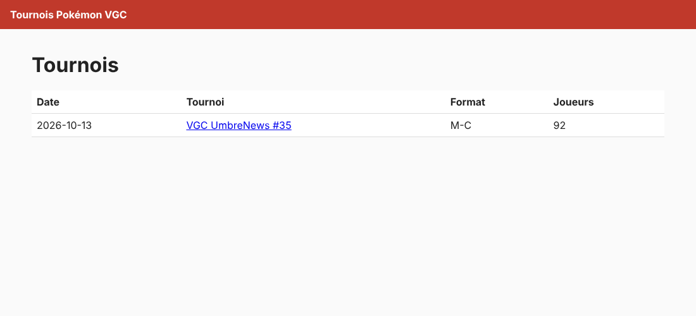

### Détail d'un tournoi : top 16, équipes, sprites et drapeaux

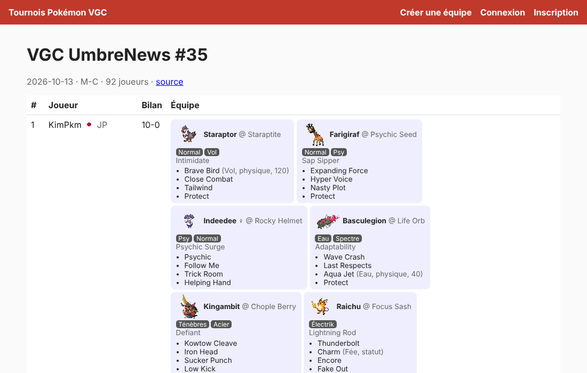

Chaque Pokémon montre son objet, son talent, ses types et ses attaques (type, catégorie, puissance), d'après les données de PokéAPI.

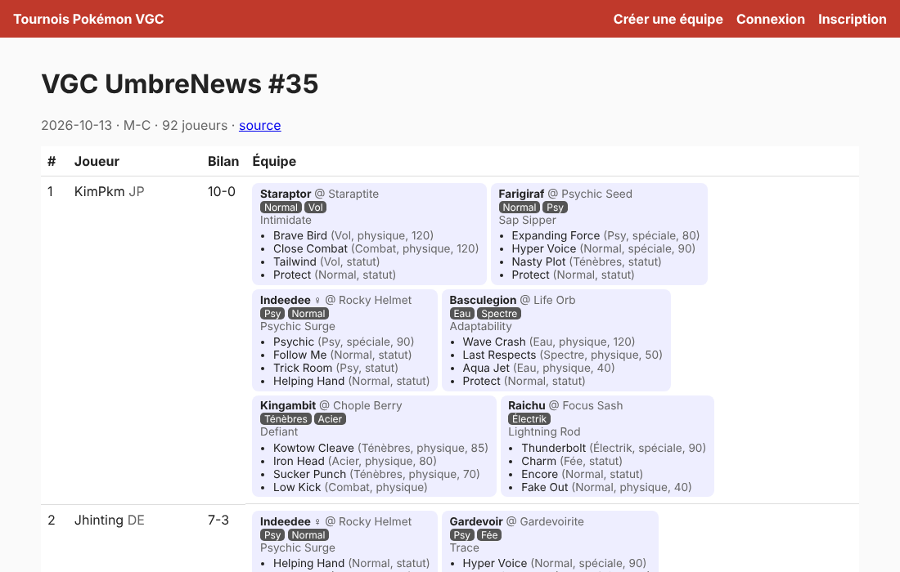

### Connexion et saisie d'un tournoi local

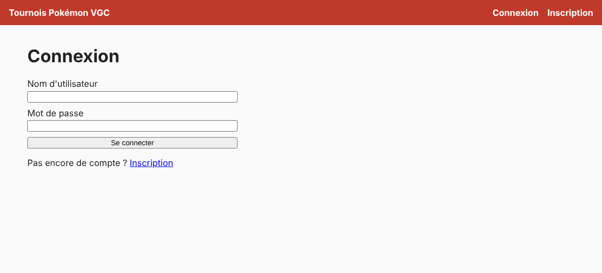

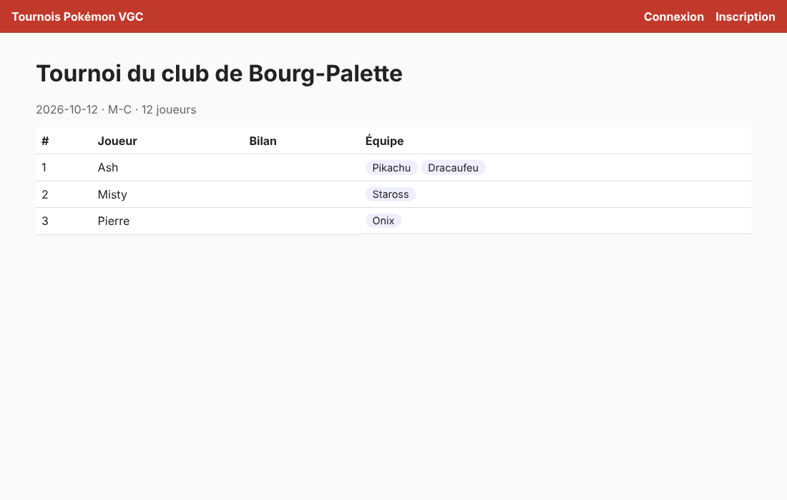

### Créateur d'équipe : statistiques de base et winrates

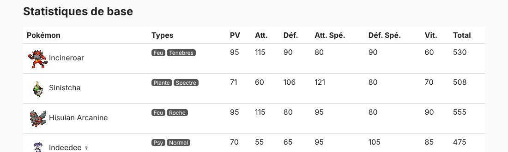

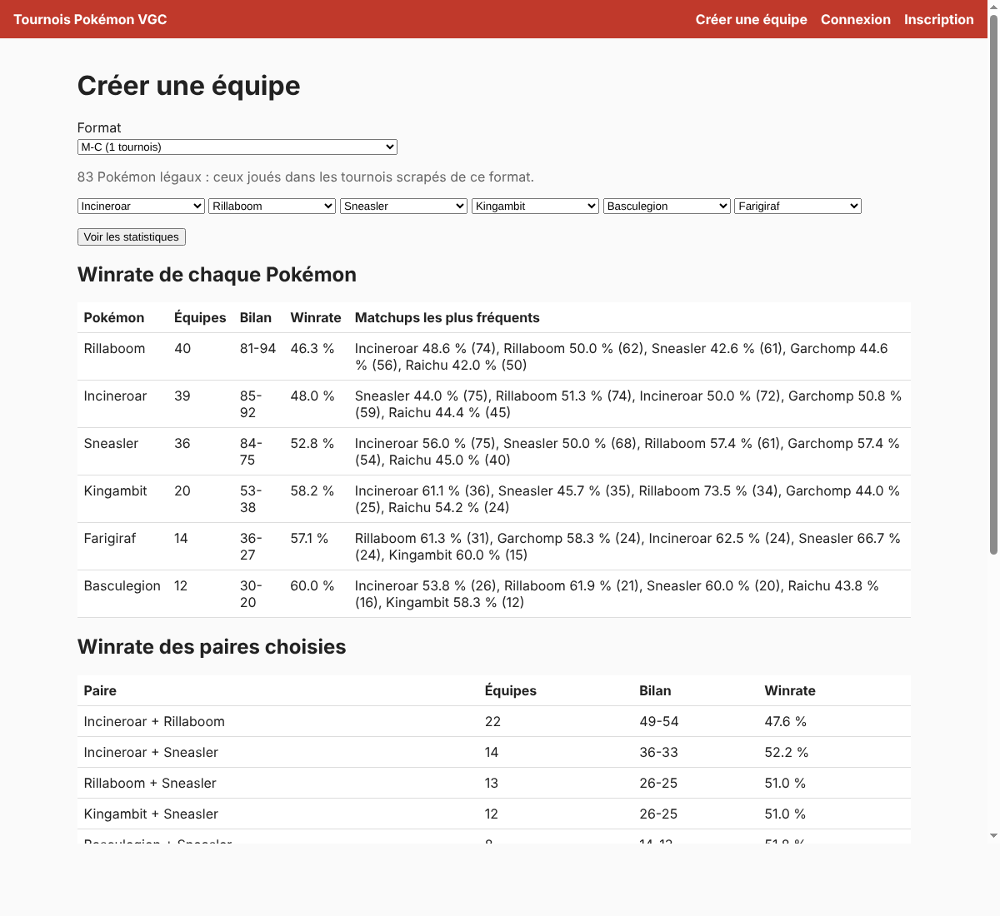

### Kubernetes (minikube)

Déployé le 15 octobre en suivant le README, sur un minikube avec Calico (qui applique les NetworkPolicy) et l'addon Ingress. Les images ont été construites dans minikube (`minikube image build`) en attendant leur publication sur Docker Hub.

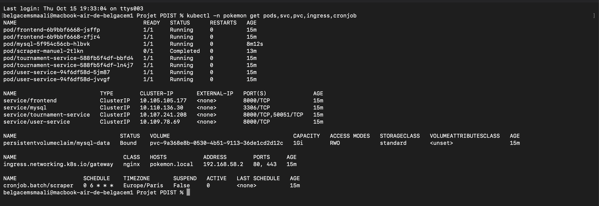

Tous les pods tournent sans redémarrage, MySQL garde ses données sur un volume persistant, la gateway répond sur `pokemon.local` en HTTP et HTTPS, et le scraper tourne chaque jour à 6 h (le pod `scraper-manuel` est un lancement à la main, qui a importé 25 tournois par gRPC).

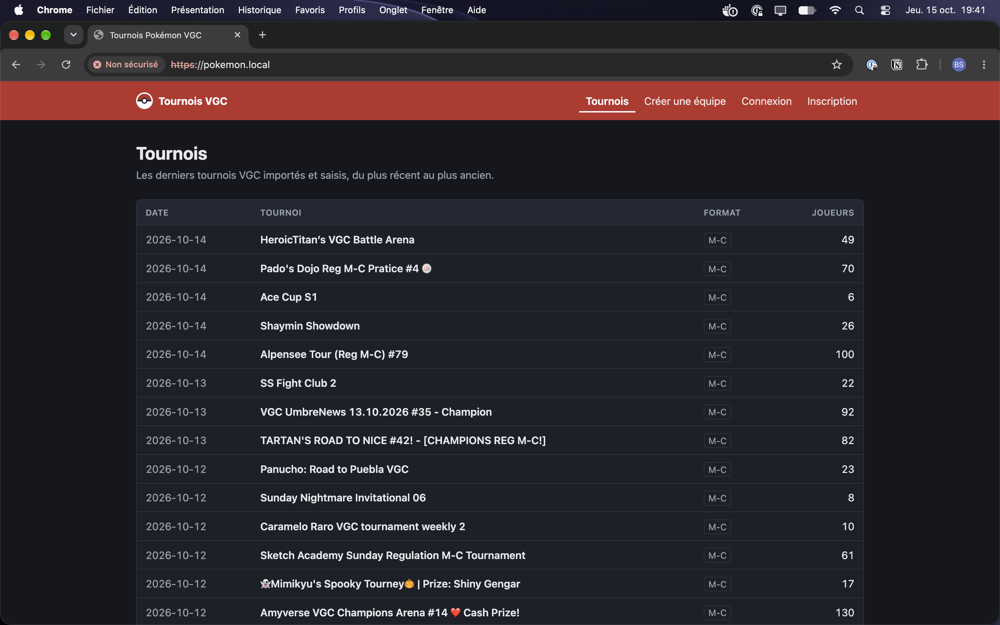

Le navigateur affiche « Non sécurisé » parce que le certificat HTTPS est auto-signé (créé avec openssl, voir le README) : le trafic est bien chiffré, mais aucune autorité ne le garantit.

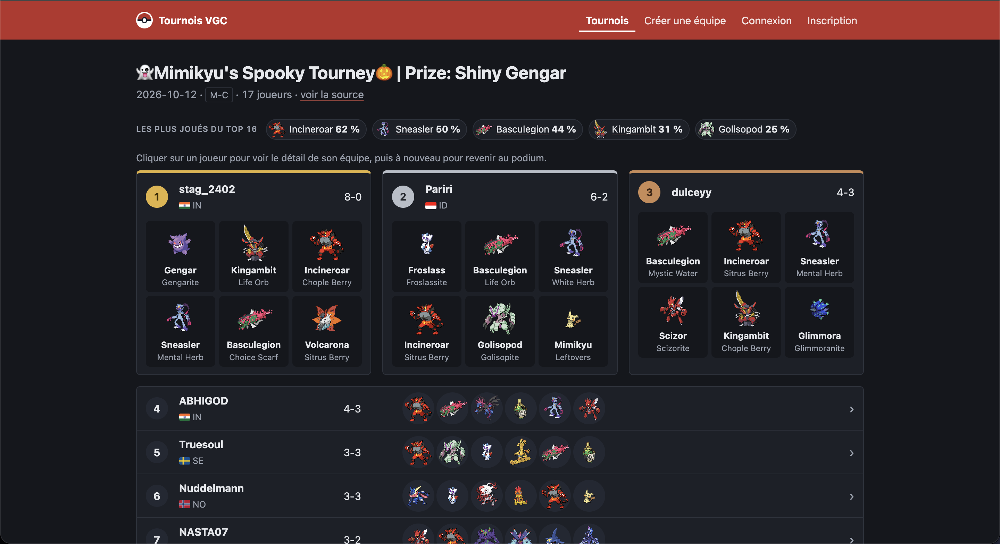

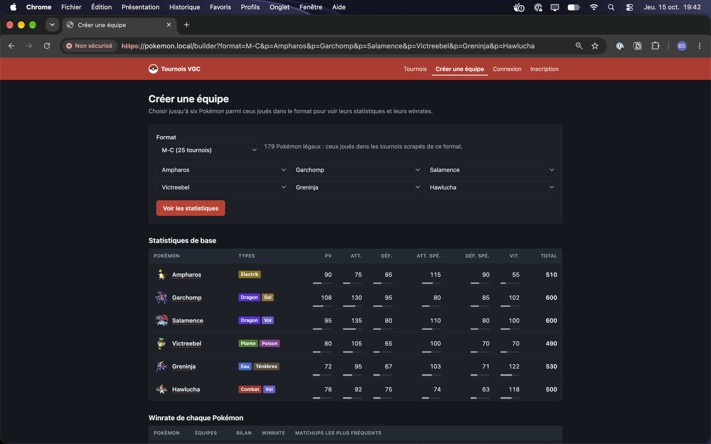

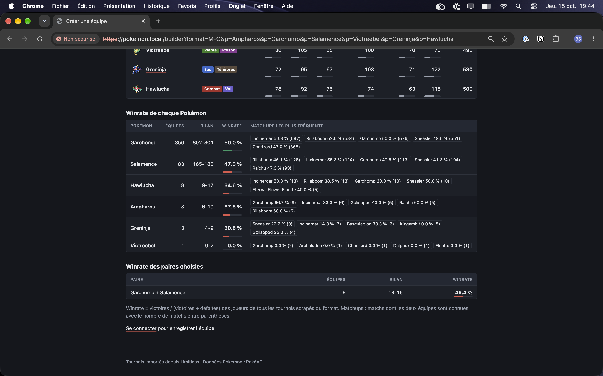

Vérifications de sécurité (commandes du README) :

| Vérification | Résultat |
|---|---|
| Le frontend joint MySQL (3306) | Refusé : `TimeoutError` |
| Le `tournament-service` joint MySQL | Autorisé |
| Le frontend joint le port gRPC du `tournament-service` (50051) | Refusé : `TimeoutError` |
| `kubectl auth can-i` pour les comptes de service du frontend et du `tournament-service` | `no` |
| Utilisateur des conteneurs | `nobody` (uid 65534), aucun jeton de compte de service monté |
| `POST https://pokemon.local/internal/import` | 404 |
| `http://pokemon.local/` | Redirigé vers HTTPS (308) |
| Suppression du pod MySQL | 25 tournois avant, 25 après |

### GKE **[À compléter]**

L'application servie depuis GKE, avec l'adresse de l'équilibreur de charge.

## 6. Qualité et tests

- **CI GitHub Actions** sur chaque PR :
  - lint et format avec ruff ;
  - `kubectl kustomize` ;
  - `terraform fmt` et `validate` ;
  - tests des quatre services, sur une vraie base MySQL jetable ;
  - construction des quatre images.
- **149 tests** au 15 octobre : 66 pour le `tournament-service`, 20 pour le `user-service`, 28 pour le scraper, 35 pour le frontend. Le scraper n'appelle jamais les vrais sites pendant les tests. Il utilise des réponses enregistrées de Limitless et de PokéAPI.
- **Une PR par étape**, liée à son issue, relue (revue de code) avant fusion.
- **Vérification « comme le correcteur »** : clone propre, tests verts, `docker compose up --build`, import d'un tournoi par gRPC, pages, inscription et connexion vérifiées (cases cochées dans [`docs/05-checklist-conformite.md`](../05-checklist-conformite.md)).

## 7. Choix et limites

- **Source des tournois** : l'API JSON publique de Limitless, plus stable que du HTML. Une seconde de pause entre deux requêtes et un `User-Agent` explicite.
- **Tous les joueurs sont enregistrés, seul le top 16 est affiché** : sinon les winrates ne seraient calculés que sur des joueurs qui ont gagné.
- **Pokémon légaux** : ceux joués dans les tournois scrapés du format courant. C'est plus simple que de recopier le règlement, et cela suit ses changements.
- **Sécurité** : pas de service mesh ni de mTLS. Les NetworkPolicy et le HTTPS couvrent le palier sans ajouter Istio. Le gRPC interne n'est pas chiffré, mais seul le scraper peut joindre son port.
- **Images externes** : sprites (dépôt GitHub de PokéAPI) et drapeaux (flagcdn.com) sont chargés par le navigateur. Une URL de sprite qui ne vient pas de PokéAPI est refusée.

## 8. Labs Google **[À compléter]**

- Captures du profil Skills Boost de chaque membre du binôme (colonne MLSD).
- Rapports sur les deux derniers labs.
